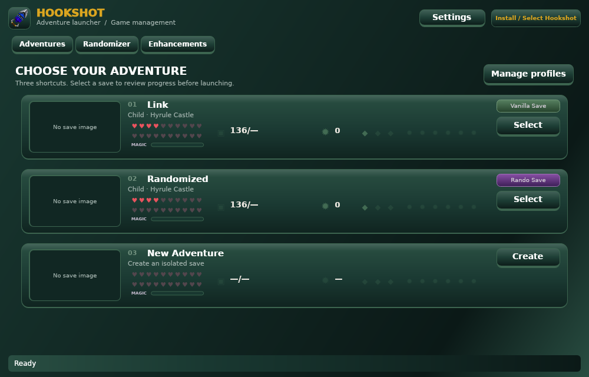
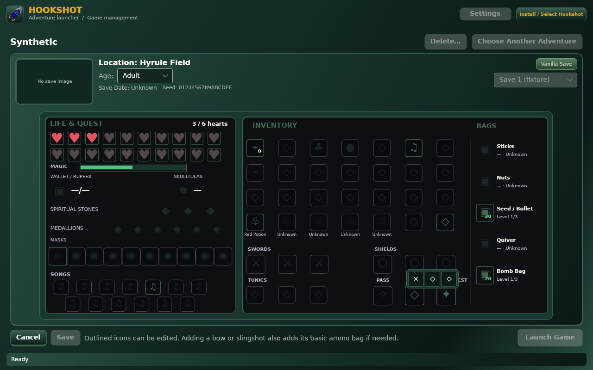
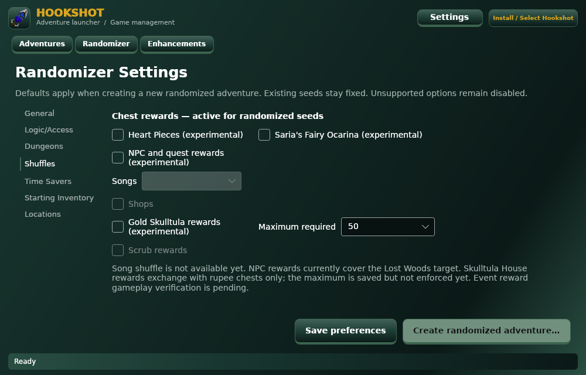
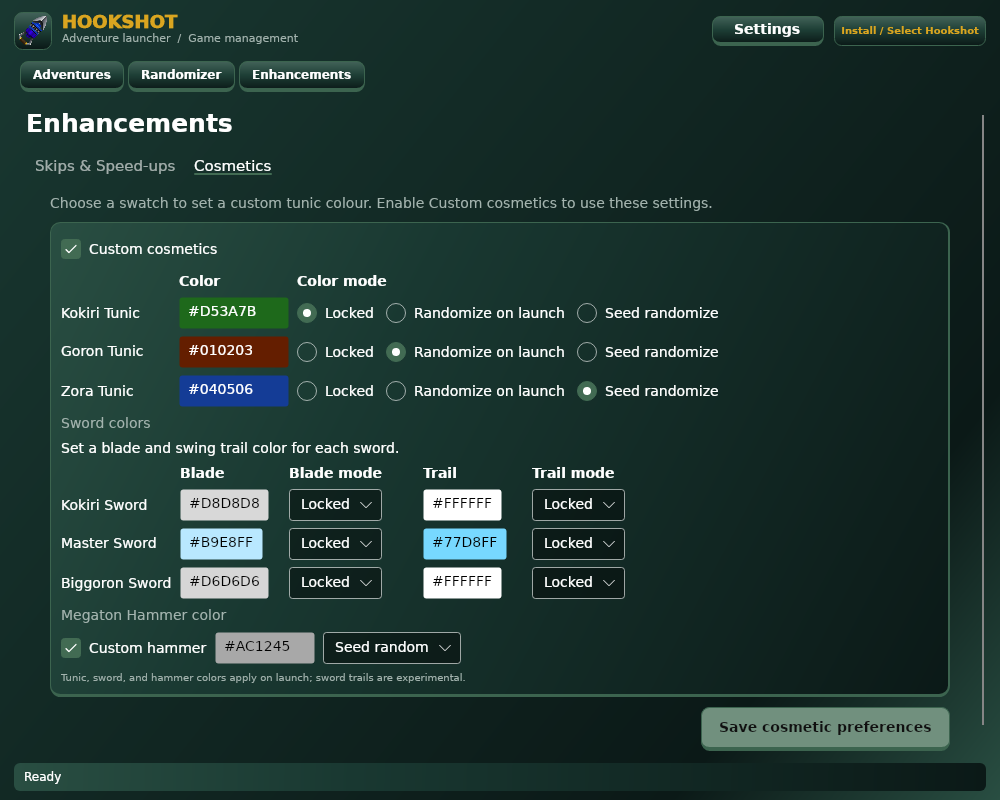

# Hookshot Adventure Launcher

**Version 0.9.01 alpha · C# / .NET / Avalonia**

Hookshot Adventure Launcher brings profiles, save management, an in-place save editor, experimental randomizer settings, and visual customization together in one interface for Hookshot. Choose an adventure, review a save, and launch it from a desktop or Steam Deck-sized window.

> **Alpha source update:** This is for testing, not a finished randomizer or a ready-to-run game download. Some checks and event rewards remain vanilla, full-game beatability is not established, and several features still need gameplay testing. Back up important saves before experimenting.

[Set up the launcher](#setup) · [Save editor](#save-editor) · [Randomizer](#randomizer) · [Enhancements](#enhancements) · [Testing and limitations](#testing-and-limitations)

## Adventures and saves

Create separate vanilla or randomized adventures and keep their saves in individual profiles. The adventure screen offers three shortcuts and a profile manager; select a profile to see its save slots, location, hearts, inventory, equipment, songs, and quest progress before launching. External saves can also be selected. Slot and adventure deletion are separate actions with confirmation.



The screenshots below use **synthetic saves and placeholder icons**. With a supported local game selected, the launcher can build its private icon cache from that installation and show its save images. No extracted icons or game files are included here.

## Save editor

Open an adventure, select a save slot, and choose **Edit Save**. Editing happens directly on the inventory screen:

- Click supported items and songs to add or remove them. Masks and trade items are managed independently.
- Use the horizontal icon choices for bottles, bags, ocarinas, hookshot, strength, the Silver/Golden Scale, and trade items. Hover over supported consumables for a quantity slider.
- Click hearts or the magic meter to change their levels; use the age selector where the save supports it.
- Select **Save** to write staged changes, or **Cancel** to discard them. The editor checks for external modifications and backs up replaced files under the selected game folder's `save-backups/`.

Adding a slingshot or bow also adds its basic seed bag or quiver when needed. Some fields are unavailable in particular saves, and equipped swords and shields must be unequipped in game before removal. Close the game before editing.



## Randomizer

The randomizer is being developed around [Ship of Harkinian's randomizer](https://www.shipofharkinian.com/randomizer) as a reference for its settings, placement, and world logic. Hookshot Adventure's implementation is still in development and does not yet have feature parity; see the [world logic notes](builder/Adventure/docs/WORLD_LOGIC.md) for the current approach.

Create a randomized adventure with a profile-bound seed and configure the next seed from **Randomizer**. Existing seeds keep their recorded settings. The launcher scans the player's local game files for supported chest locations and lets players mark individual checks as filler-only. It also provides starting equipment, songs, consumables, and maps/compasses; supported chest sources for starting items are replaced with blue rupees.

Reviewed heart-piece chests and limited Saria, Lost Woods target, and one-time Skulltula House reward exchanges are experimental. Open Forest and Open Deku options are also experimental. The Skulltula maximum is stored as a preference but **is not enforced by the solver**. Randomized adventures use a separate 20-bombchu capacity without granting a bomb bag.



The opening logic has checks, but the solver does not prove a full game is beatable. Event reward coverage is partial, and ammunition chests can still give arrows, bombs, or seeds before the corresponding bag is owned. Song, shop, and scrub shuffles and several other features are not implemented. See the [testing handoff](builder/Adventure/docs/TESTING_HANDOFF.md) before starting a test seed.

## Enhancements

Configure supported skips and speed-ups, including opening scenes, selected Deku sequences, child stealth, owl scenes, and fast text. Cosmetic controls offer tunic colors and modes, sword blade and swing-trail colors, and a hammer color. Some skips and cosmetic combinations remain experimental and need more gameplay coverage.



## Setup

This repository contains launcher source and a version-specific integration patch; it does **not** contain the native Hookshot source tree, a built game, or game files. The documented source setup currently targets Linux and requires the .NET 10 SDK, Git, and Hookshot's own build requirements. Windows and Steam Deck package installation have not been validated for this update.

1. Obtain a fresh Hookshot v3.0.0 source checkout at the supported revision, along with your own compatible game files:

   ```sh
   git clone https://git.notrexed.dev/Hookshot/Hookshot.git Hookshot-v3.0.0
   git -C Hookshot-v3.0.0 checkout 29619a1cdc9d15e450761600f4e8adc0ba14e23e
   ```

2. From a checkout of this launcher repository, apply the integration to that fresh Hookshot checkout:

   ```sh
   ./install-into-hookshot.sh /path/to/Hookshot-v3.0.0
   ```

   The installer checks that the patch applies and refuses to overwrite an existing Adventure installation. Use a separate checkout for testing.

3. From the Hookshot checkout, start the launcher:

   ```sh
   ./hookshot-dev.sh
   ```

   Select an existing Hookshot installation with retained game files, a local NUP, or an extracted game folder in the setup wizard. Adventure can build a separate development installation; its native hooks must be rebuilt before randomized profiles can run. The copy needs additional disk space.


`./hookshot-dev.sh --builtin` opens the original Hookshot Builder. The launcher interface and randomizer preparation use C#; Hookshot's own build pipeline and save-editor backend still use Python. Detailed instructions, including build-tool setup and the local icon cache, are in the [Adventure documentation](builder/Adventure/README.md).

## Testing and limitations

Run `./hookshot-dev.sh --test` from the integrated Hookshot checkout for the C# core smoke tests. The [testing handoff](builder/Adventure/docs/TESTING_HANDOFF.md) records known issues and gameplay scenarios; game-free tests do not establish compatibility or beatability. The original v0.8 source remains in `builder/qt/` for reference.

## Game data and license

Game files, saves, generated binaries, extracted textures, and caches stay on the player's PC and are not distributed by this repository. The launcher is GPL-3.0; see [LICENSE](LICENSE) and the relevant third-party notices. Hookshot and game names are used descriptively; this project is not affiliated with Nintendo.
