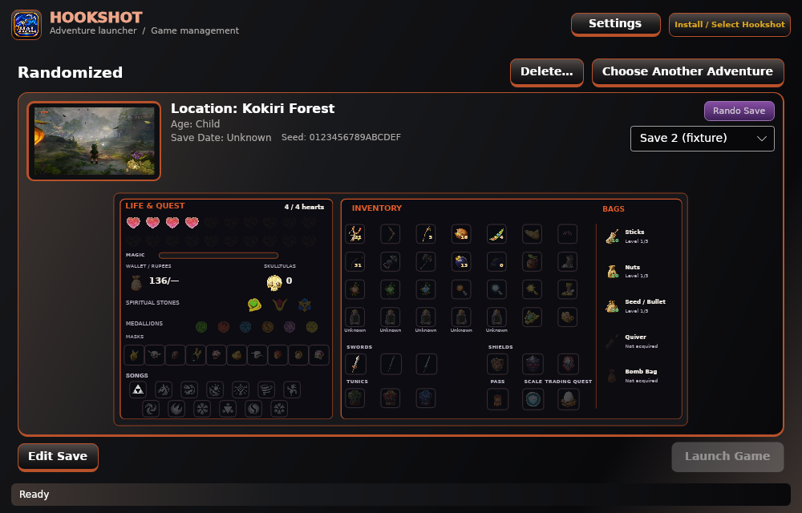
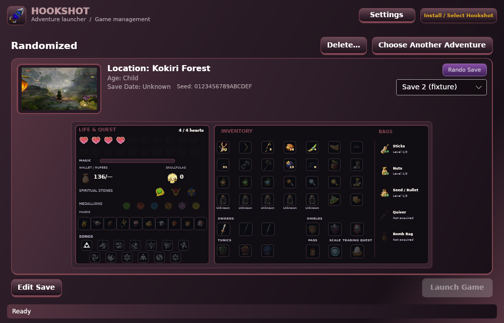
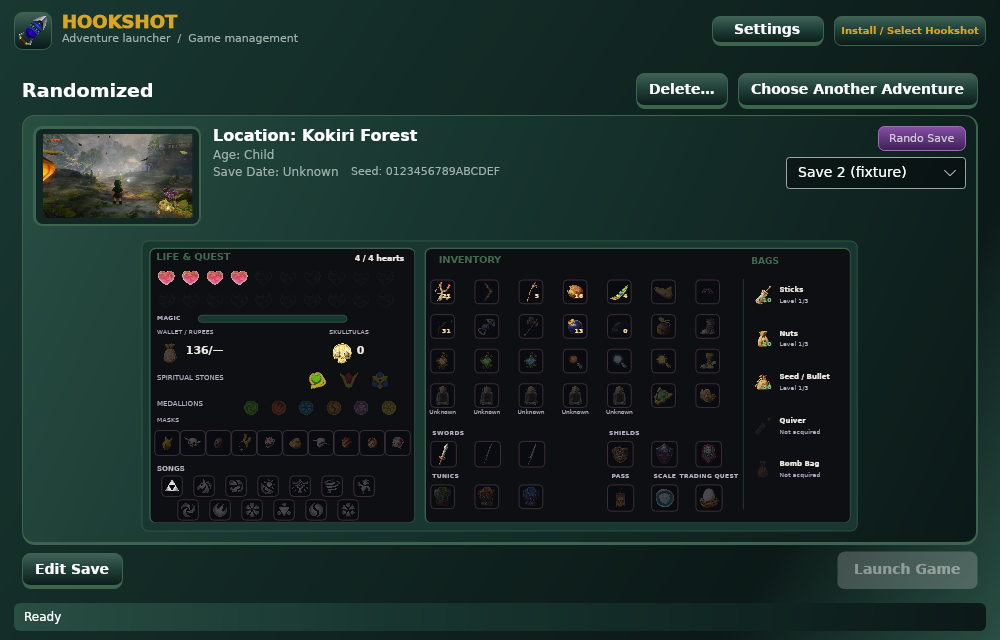
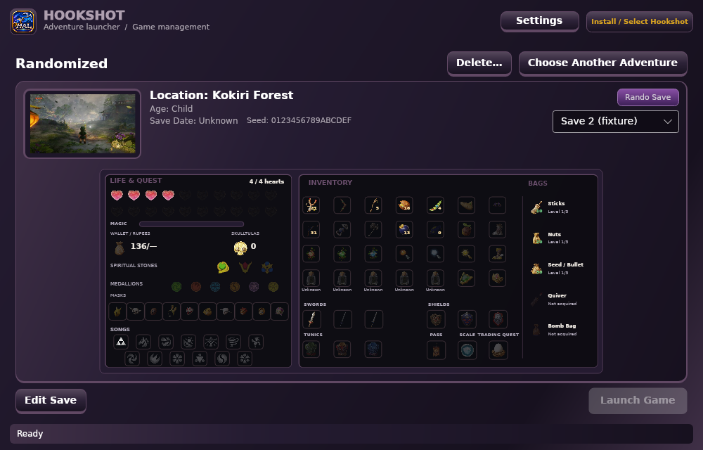
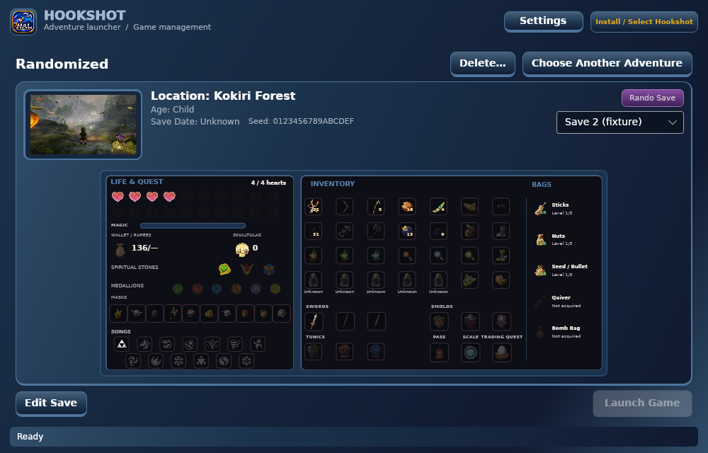
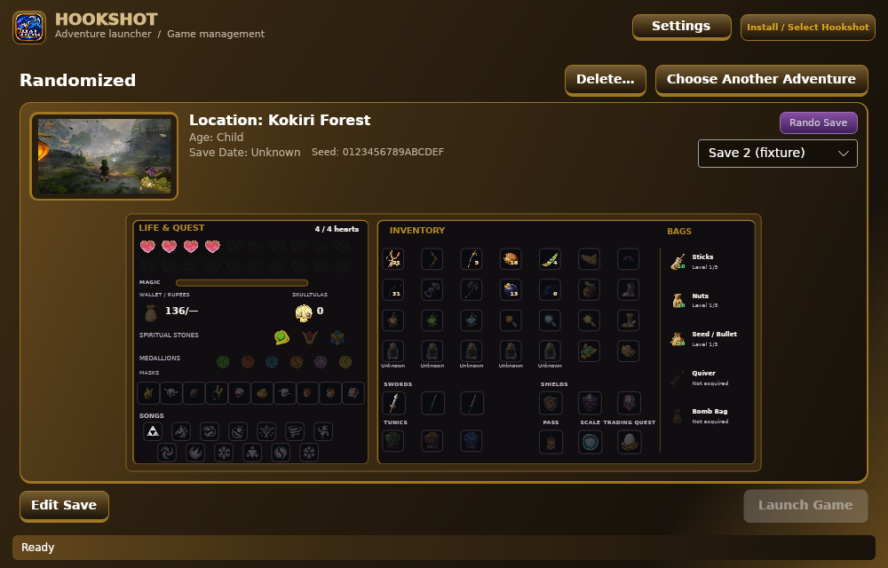
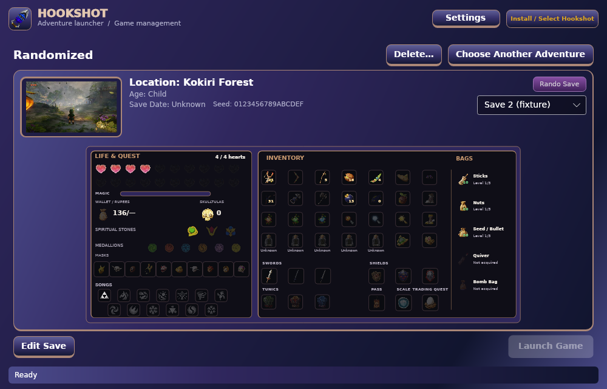
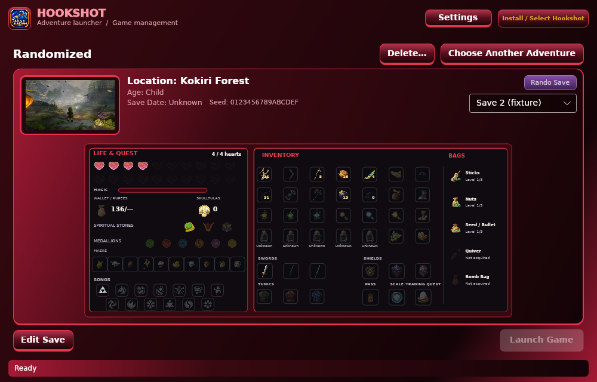
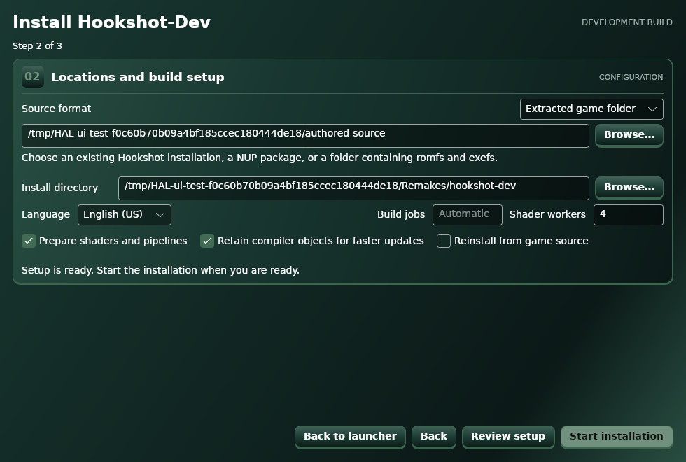

# Hookshot Adventure Launcher

**Version 0.9.02a · C# / .NET / Avalonia**

Hookshot Adventure Launcher brings profiles, save management, an in-place save editor, experimental randomizer settings, and visual customization together in one interface for Hookshot. Choose an adventure, review a save, and launch it from a desktop or Steam Deck-sized window.

> **0.9.02a alpha:** This is for testing, not a finished randomizer or a game download. Some checks and event rewards remain vanilla, full-game beatability is not established, and several features still need gameplay testing. Back up important saves before experimenting.

The default branch contains the 0.9.02a source for Hookshot 3.0.2. The earlier v0.8 source is retained on the `release/v0.8` branch and under `builder/qt/`.

## What's new in 0.9.02a

- Supports Hookshot 3.0.2 with the 0.9.01 guided development-build setup and launcher features.
- Randomized ammo chests use a blue rupee when the matching bag is missing. Large chests keep their size; more chest variants and bag-owned cases still need gameplay testing.
- Bombchus hold 20 before a bomb bag is found, then match the bag's 20, 30, or 40 capacity. The save editor follows the same rule.
- Improves starting-consumable visibility and automatically locates or obtains the ASTC codec needed for cosmetic patches.
- Includes the Hookshot 3.0.2 moving-roll input fix and an updated development launcher script.

[Set up the launcher](#setup) · [Save editor](#save-editor) · [Randomizer](#randomizer) · [Enhancements](#enhancements) · [Themes](#themes) · [Testing and limitations](#testing-and-limitations) · [Report an issue](#reporting-an-issue)

## Adventures and saves

Create separate vanilla or randomized adventures and keep their saves in individual profiles. The adventure screen offers three shortcuts and a profile manager; select a profile to see its save slots, location, hearts, inventory, equipment, songs, and quest progress before launching. External saves can also be selected. Slot and adventure deletion are separate actions with confirmation.


These screenshots use example profiles and a captured game scene to illustrate the launcher. Inventory icons are displayed using the local game's artwork; the generated icon cache, game files, and personal saves are not included in this repository.


## Save editor

Open an adventure, select a save slot, and choose **Edit Save**. Editing happens directly on the inventory screen:

- Click supported items and songs to add or remove them. Masks and trade items are managed independently.
- Use the horizontal icon choices for bottles, bags, ocarinas, hookshot, strength, the Silver/Golden Scale, and trade items. Hover over supported consumables for a quantity slider.
- Click hearts or the magic meter to change their levels; use the age selector where the save supports it.
- Select **Save** to write staged changes, or **Cancel** to discard them. The editor checks for external modifications and backs up replaced files under the selected game folder's `save-backups/`.

Adding a slingshot or bow also adds its basic seed bag or quiver when needed. Some fields are unavailable in particular saves, and equipped swords and shields must be unequipped in game before removal. Close the game before editing.


## Randomizer

The randomizer is being developed around [Ship of Harkinian's randomizer](https://www.shipofharkinian.com/randomizer) as a reference for its settings, placement, and world logic. Hookshot Adventure's implementation is still in development and does not yet have feature parity; see the [world logic notes](builder/Adventure/docs/WORLD_LOGIC.md) for the current approach.

Create a randomized adventure with a profile-bound seed and configure the next seed from **Randomizer**. Existing seeds keep their recorded settings. The launcher scans the player's local game files for supported chest locations and lets players mark individual checks as filler-only. It also provides starting equipment, songs, consumables, and maps/compasses; supported chest sources for starting items are replaced with blue rupees.

Reviewed heart-piece chests and limited Saria, Lost Woods target, and one-time Skulltula House reward exchanges are experimental. Open Forest and Open Deku options are also experimental. The Skulltula maximum is stored as a preference but **is not enforced by the solver**. Randomized adventures hold 20 bombchus before a bomb bag, then follow the bag's 20, 30, or 40 capacity.


The opening logic has checks, but the solver does not prove a full game is beatable. Event reward coverage is partial, and the conditional ammo-chest behavior still needs testing across more chest variants and bag-owned cases. Song, shop, and scrub shuffles and several other features are not implemented. See the [testing handoff](builder/Adventure/docs/TESTING_HANDOFF.md) before starting a test seed.

## Enhancements

Configure supported skips and speed-ups, including opening scenes, selected Deku sequences, child stealth, owl scenes, and fast text. Cosmetic controls offer tunic colors and modes, sword blade and swing-trail colors, and a hammer color. Some skips and cosmetic combinations remain experimental and need more gameplay coverage.


## Themes

Choose **Settings → Visual theme** to personalize the launcher. Your choice is saved between sessions and does not alter your game or saves. Here are the eight current themes:

| Darunia | Gannon |
| --- | --- |
|  |  |
| **Link** | **Royal** |
|  |  |
| **Ruto** | **Tri-force** |
|  |  |
| **Zelda** | **Ruby** |
|  |  |

The launcher also provides settings for game launches, shader and pipeline tools, and development build and shader worker counts. Its compact layouts are designed for desktop and Steam Deck-sized screens; the alpha still needs wider hardware testing.

## Download and setup

[Download 0.9.02a](https://github.com/kintera/HookshotAdventureLauncher/releases/tag/v0.9.02a)

- **Linux x86-64:** Download the AppImage, make it executable (`chmod +x HookshotAdventure-0.9.02a-Linux-x86_64.AppImage`), then run it. HAL updates are manual in this alpha.
- **Windows x86-64 (experimental):** Download and extract the experimental ZIP, then run `HookshotAdventure.App.exe`. The launcher has been cross-built but has not yet been tested on Windows. Building Hookshot-Dev requires additional Windows build tools; see the included `READ-ME-FIRST.txt` and `CONTRIBUTING.md`.

When a randomized adventure needs a compatible build, choose **Set up randomizer build**. HAL guides you through selecting your game files and building a separate Hookshot-Dev installation, with a progress bar and live log. Windows build prerequisites are required separately.

Both packages require your own compatible game files; neither contains a game dump or built game. Randomized adventures require a HAL-compatible Hookshot-Dev build. Updating that build can remove the randomizer hooks, so rebuild it with HAL before playing randomized adventures. Steam Deck installation still needs wider testing.

### Building from source

This repository contains launcher source and a version-specific integration patch; it does **not** contain the native Hookshot source tree, a built game, or game files. The source setup below targets Linux and requires the .NET 10 SDK, Git, and Hookshot's own build requirements.

1. Obtain a fresh Hookshot v3.0.2 source checkout at the supported revision, along with your own compatible game files:

   ```sh
   git clone https://git.notrexed.dev/Hookshot/Hookshot.git Hookshot-v3.0.2
   git -C Hookshot-v3.0.2 checkout a2b7f97976bb8538d6c7d5a4d01a05606c8d0cff
   ```

2. Check out this launcher source and apply its integration to the fresh Hookshot checkout:

   ```sh
   git clone https://github.com/kintera/HookshotAdventureLauncher.git
   cd HookshotAdventureLauncher
   ./install-into-hookshot.sh /path/to/Hookshot-v3.0.2
   ```

   The installer checks that the patch applies and refuses to overwrite an existing Adventure installation. Use a separate checkout for testing.

3. From the Hookshot checkout, start the launcher:

   ```sh
   ./hookshot-dev.sh
   ```

   Select an existing Hookshot installation with retained game files, a local NUP, or an extracted game folder in the setup wizard. Adventure can build a separate development installation; its native hooks must be rebuilt before randomized profiles can run. The copy needs additional disk space.



`./hookshot-dev.sh --builtin` opens the original Hookshot Builder. The launcher interface and randomizer preparation use C#; Hookshot's own build pipeline and save-editor backend still use Python. Detailed instructions, including build-tool setup and the local icon cache, are in the [Adventure documentation](builder/Adventure/README.md).

The setup wizard offers an existing Hookshot installation with retained game files, a local `.nup`, or an extracted game folder. If no installation is detected, it can download the official Hookshot Builder; use that with your own game files, then return to HAL and choose the installed game as the source for Hookshot-Dev. The wizard can configure the language, build jobs, shader workers and retained objects. A separate development installation protects the existing installation and needs additional disk space. The launcher can prepare its Linux build tools and rebuild its local icon database; see the [installation and icon notes](builder/Adventure/README.md#game-installation-and-updates).

## Repository layout

```text
builder/Adventure/src/HookshotAdventure.App/   Avalonia launcher interface
builder/Adventure/src/HookshotAdventure.Core/  Profiles, randomizer, and shared logic
builder/Adventure/src/HookshotAdventure.Cli/   Local research and resource tools
builder/Adventure/tests/                       Game-free launcher tests
builder/Adventure/docs/                        Design and testing notes
integration/hookshot-v3.0.2.patch               Version-specific native integration
install-into-hookshot.sh                       Checked integration installer
builder/qt/                                    Earlier v0.8 launcher source
```

## Testing and limitations

Run `./hookshot-dev.sh --test` from the integrated Hookshot checkout for the C# core smoke tests. The [testing handoff](builder/Adventure/docs/TESTING_HANDOFF.md) records known issues and gameplay scenarios; game-free tests do not establish compatibility or beatability. The original v0.8 source remains in `builder/qt/` for reference. Read the [0.9.02a release notes](docs/RELEASE_0.9.02a.md); notes for [0.9.01 alpha.1](docs/RELEASE_0.9.01_ALPHA1.md), [0.9.01 alpha](docs/RELEASE_0.9.01.md), and [earlier releases](docs/RELEASE_NOTES.md) remain available.

For the original port plan, see the [HAL 0.9.02 handoff](builder/Adventure/docs/HAL_0.9.02_HOOKSHOT_3.0.2_HANDOFF.md). Current results and remaining checks are in the [testing handoff](builder/Adventure/docs/TESTING_HANDOFF.md).


## Reporting an issue

Please report problems through [GitHub Issues](https://github.com/kintera/HookshotAdventureLauncher/issues) and/or the report-issue area of our [Discord server](https://discord.gg/xETQwGr9W). Include your HAL and Hookshot versions, operating system and GPU, what happened, and the steps and location needed to reproduce it. For randomizer problems, include the seed and relevant settings.

If possible, capture an F9 gameplay trace around the problem:

1. In HAL, enable **Settings → Debug → Debug Key (F9 gameplay trace)** before launching the game.
2. Press **F9** just before reproducing the issue to start recording.
3. Reproduce the issue, then press **F9** again to stop recording.
4. Find the timestamped `gameplay_trace_*.log` file in the selected game installation's `logs/` folder. Attach it to your GitHub issue and/or Discord report. If available, include `logs/hookshot_log.txt` as well.

If the game crashes or you cannot capture a trace, please still report what happened and include any available log. Review logs for personal information before sharing, and do not upload game files, saves, or extracted game resources.

## Game data and license

Game files, saves, generated binaries, extracted textures, and caches stay on the player's PC and are not distributed by this repository. The launcher is GPL-3.0; see [LICENSE](LICENSE) and the relevant third-party notices. Hookshot and game names are used descriptively; this project is not affiliated with Nintendo.

This repository is the launcher source component for a compatible Hookshot checkout. It does not replace the Hookshot engine, its build requirements, or the player's own game files.
