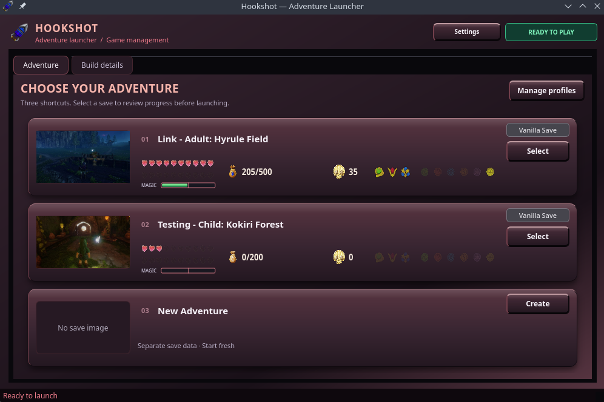
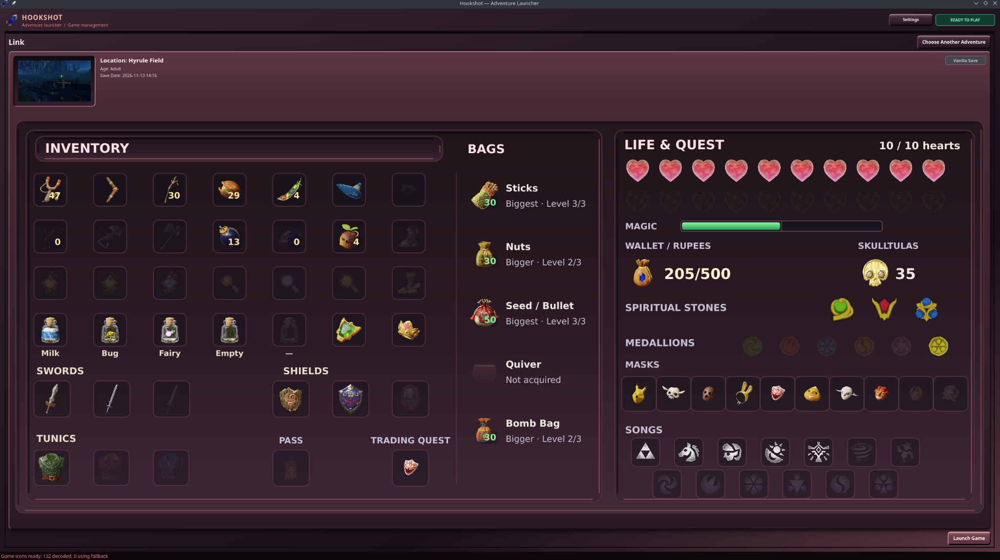
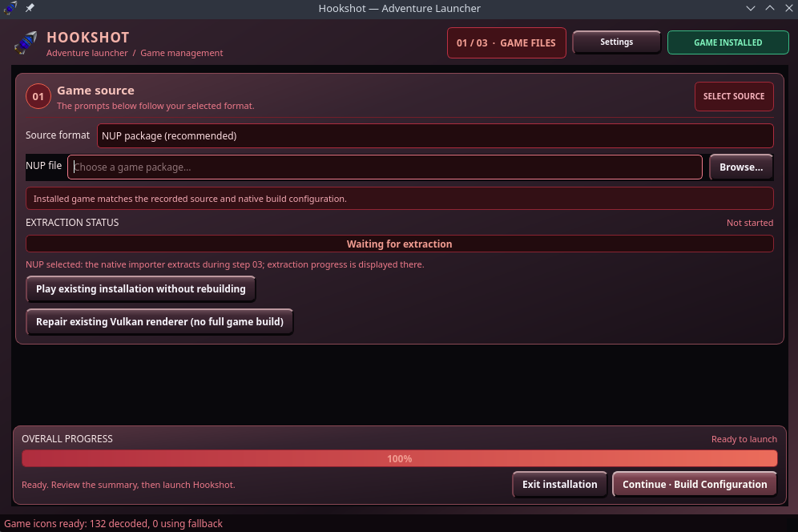
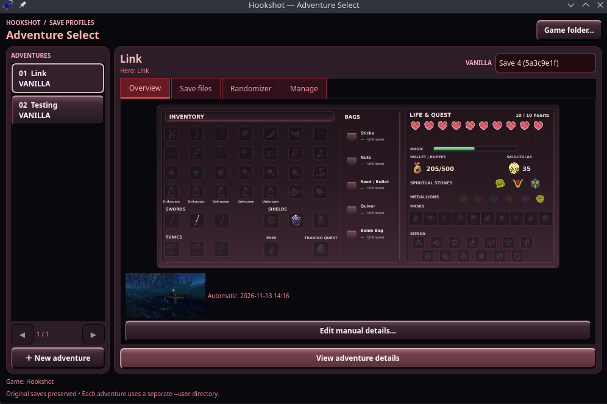

# Hookshot Adventure Launcher

**Your adventure, your saves, your way.**

Hookshot Adventure Launcher is a customizable **PyQt6 launcher and save manager for Hookshot**. Built with desktop Linux and Steam Deck-sized screens in mind, it brings game launching, multiple independent adventures, and a detailed view of your save progression into one streamlined interface.

Choose an adventure, review your progress, manage your saves, and launch the game without digging through save folders or configuration files. Its game-inspired visual themes, compact cards, and decoded inventory view put the adventure at the center of the experience.

> **Project status:** Active development / preview. This repository contains the **Python launcher, save-management UI, tests, and theme resources**—not the Hookshot native engine, compiler, shaders, copyrighted game data, or a prebuilt game. The installer/build pages require a compatible full Hookshot source checkout.

## Highlights

- **Adventure Select:** three quick-access adventure slots with automatically populated save summaries and profile management.
- **Independent saves:** manage distinct adventures without overwriting the original save; managed profiles can be moved to recoverable trash with confirmation.
- **Detailed progress viewer:** hearts, magic, wallet, spiritual stones, medallions, inventory, masks, equipment, trading quest, bags, and a 13-song grid (7 + 6).
- **Authentic icon mappings:** references the local game's own icons where available; extracted game files and assets are **not** included in this repository.
- **Customization:** eight theme styles, along with launch and shader/pipeline warm-up settings.
- **Desktop & handheld UI:** designed for compact windows and Steam Deck-oriented layouts, with a responsive Adventure Select page.
- **Read-only save decoding:** display save information without editing gameplay saves. Some progression indicators are still being verified against real saves.

## Screenshots

### Adventure Select

Three compact profile shortcuts with live save summaries and a one-click path to your next adventure.



### Adventure Details

A rich, read-only view of inventory, bag upgrades, equipment, heart containers, masks, medallions, songs, and quest progression.



### Installation and configuration

An integrated setup interface for connecting the launcher to a compatible native Hookshot build.



### Save management (earlier UI preview)

This screenshot shows an earlier save-management design. The current launcher removes the manual-details editor and derives supported progress information from the save automatically.



## Themes

Personalize the entire launcher with **eight built-in themes**. Each theme uses the same compact Adventure Select, profile manager, installer, and settings layouts. Switching themes does not change your game files or save data.

| Theme | Look |
| --- | --- |
| **Darunia** | Charcoal, basalt, and ember-orange highlights |
| **Gannon** | Dark plum with muted rose accents |
| **Link** | Deep emerald green |
| **Royal** | Rich, subdued purple |
| **Ruto** | Cool crystal blue |
| **Tri-force** | Antique gold and dark bronze |
| **Zelda** | Blue-violet with soft pink accents |
| **Ruby** | Deep garnet, crimson, and vivid ruby-magenta highlights |

Select a theme from **Settings → Visual theme**. The selection persists across launcher sessions. Ruby is new in this preview and needs visual verification on desktop and Steam Deck-sized layouts.

## Requirements

- Linux desktop environment (Manjaro/KDE is the main development environment; Steam Deck-oriented layout)
- Python 3.10+ and PyQt6
- Compatible Hookshot installation/source for building and launching the game
- Additional Python libraries listed in `builder/qt/runtime_requirements.txt`

## Run from a compatible Hookshot checkout

This repository mirrors the launcher subtree's expected paths. For the **full installation/build experience**, place the included `builder/qt/` directory and `assets/hookshot.png` into a compatible Hookshot source checkout, preserving those relative locations and the checkout's own `nx2/` directory. Then run:

```bash
python3 -m pip install -r builder/qt/runtime_requirements.txt
./builder/qt/start-hookshot-launcher.sh
```

For systems with an externally managed Python environment (including many Arch/Manjaro installations), install dependencies with the system package manager or a compatible isolated environment instead of forcing a system-wide pip installation. The start script uses the selected system Python or `HOOKSHOT_PYTHON` if set.

**Important:** Cloning *only this repository* does **not** supply the native builder (`nx2/make_game.py`), game binaries, or game data. It is intended as a separate, versioned home for the launcher code, to be integrated with the compatible native Hookshot project.

## Repository layout

```text
assets/hookshot.png            Launcher brand icon
builder/qt/hookshot_qt.py     Main PyQt6 launcher
builder/qt/profile_gui.py    Profile management interface
builder/qt/profile_store.py  Profile persistence and managed saves
builder/qt/save_reader.py    Read-only game-save decoding
builder/qt/zelda_summary_widget.py  Adventure progress display
builder/qt/assets/game_icons/icon_manifest.json  Game icon role mappings
builder/qt/*.qss             UI themes
builder/qt/test_*.py         Source-level regression tests
```

## Testing

From the repository root:

```bash
python3 -m unittest discover -s builder/qt -p 'test_*.py'
```

Visual verification requires PyQt6 and a display environment. Tests do not replace in-game validation of save-field interpretations.

## Save safety and data distribution

The launcher is intended to read and manage saves without editing their game-progress values. Only explicitly managed profiles can be deleted via the launcher, with a confirmation step and recoverable trash. **Back up important saves before experimenting with preview software.**

This source distribution deliberately **excludes saves, ROMs, extracted textures, compiled binaries, personal paths, caches, and other game assets**. The icon manifest names expected files in a local game installation; those files are not redistributed.

## Relationship to Hookshot

This repository is the standalone **launcher source component** for a compatible Hookshot game port. It is not the native game engine or a replacement for the official game installation/build requirements. Game and character names are used descriptively; no affiliation with Nintendo is claimed.

## License

GPL-3.0, retaining the licensing terms from the source project. See [LICENSE](LICENSE). Review upstream copyright notices and third-party dependencies before redistribution.
